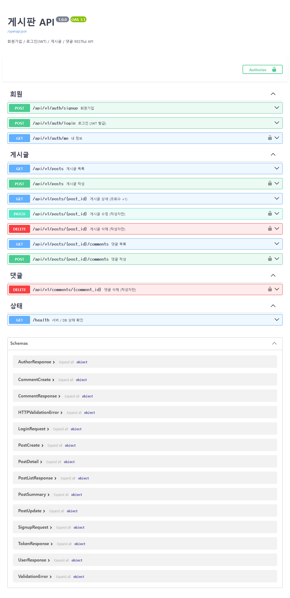
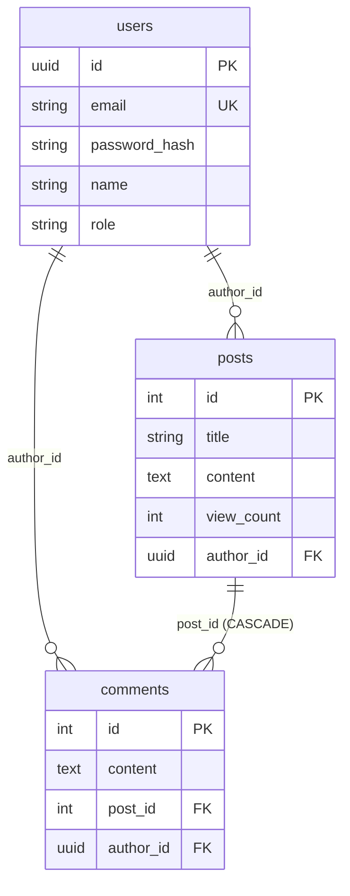

# 게시판 API (FastAPI + PostgreSQL + JWT)

회원가입 / 로그인(JWT) / 게시글 / 댓글 기능을 가진 RESTful 게시판 API입니다.

- 배포 주소 (Swagger UI): (EC2 배포 후 추가)
- GitHub: https://github.com/imeab/board-api

## 기술

- FastAPI, Pydantic (요청 검증 / 응답 직렬화)
- PostgreSQL + SQLAlchemy 2.0 (async, asyncpg)
- JWT (PyJWT), bcrypt 비밀번호 해싱
- uv, Docker Compose, AWS EC2

## API 목록

| 메서드 | 경로 | 설명 | 로그인 |
|---|---|---|---|
| POST | `/api/v1/auth/signup` | 회원가입 | |
| POST | `/api/v1/auth/login` | 로그인 → JWT 발급 | |
| GET | `/api/v1/auth/me` | 내 정보 | ✅ |
| GET | `/api/v1/posts?page=1&size=10&keyword=` | 게시글 목록 (페이지, 검색) | |
| GET | `/api/v1/posts/{post_id}` | 게시글 상세 (조회수 +1) | |
| POST | `/api/v1/posts` | 게시글 작성 | ✅ |
| PATCH | `/api/v1/posts/{post_id}` | 게시글 수정 | ✅ 작성자 |
| DELETE | `/api/v1/posts/{post_id}` | 게시글 삭제 (댓글도 같이 삭제) | ✅ 작성자 |
| GET | `/api/v1/posts/{post_id}/comments` | 댓글 목록 | |
| POST | `/api/v1/posts/{post_id}/comments` | 댓글 작성 | ✅ |
| DELETE | `/api/v1/comments/{comment_id}` | 댓글 삭제 | ✅ 작성자 |
| GET | `/health` | 서버 / DB 상태 확인 | |

REST 규칙: 자원은 복수형 명사(`/posts`), 동작은 HTTP 메서드로 구분, 생성은 `201`, 삭제는 `204`.



## 인증 / 인가

1. `/auth/login`으로 로그인하면 `access_token` 발급 (기본 60분 후 만료)
2. Swagger 오른쪽 위 **Authorize** 버튼에 토큰 입력 → 이후 요청에 `Authorization: Bearer <토큰>` 자동 첨부
3. 수정 / 삭제는 **작성자 본인**(또는 ADMIN)만 가능, 아니면 `403`

- 비밀번호는 bcrypt로 해싱해서 저장
- 토큰 만료 / 위조 시 `401`
- 로그인 실패 시 이메일이 없는지 비밀번호가 틀린지 구분하지 않음 (계정 존재 여부 노출 방지)

## 에러 응답 형식

모든 에러는 같은 모양으로 응답합니다.

```json
{
  "success": false,
  "error": {
    "code": "VALIDATION_ERROR",
    "message": "입력값이 올바르지 않습니다.",
    "details": [{ "field": "email", "message": "value is not a valid email address" }]
  }
}
```

| 상황 | 상태 코드 | code |
|---|---|---|
| 입력값 오류 | 422 | VALIDATION_ERROR |
| 로그인 필요 / 토큰 오류 | 401 | UNAUTHORIZED |
| 작성자 아님 | 403 | FORBIDDEN |
| 없는 게시글 / 댓글 | 404 | NOT_FOUND |
| 이메일 중복 | 409 | CONFLICT |

## DB 구조



## 폴더 구조

```
app/
  main.py              앱 생성, 미들웨어(요청 로그 + 처리 시간), 라우터 등록
  core/config.py       환경 변수 (.env)
  core/database.py     SQLAlchemy async 엔진 / 세션
  core/security.py     bcrypt, JWT 발급 / 검증
  core/exceptions.py   커스텀 예외 + 공통 에러 응답
  models.py            ORM 모델 (User, Post, Comment)
  schemas.py           Pydantic 요청 / 응답 스키마
  deps.py              DB 세션, 현재 로그인 회원 (의존성 주입)
  routers/auth.py      회원 API
  routers/posts.py     게시글 / 댓글 API
tests/test_api.py      실제 PostgreSQL에 연결한 통합 테스트
```

## 실행 방법

### Docker Compose (DB + API 한 번에)

```bash
cp .env.example .env   # JWT_SECRET_KEY, POSTGRES_PASSWORD 수정
docker compose up -d --build
```

→ http://localhost/docs

### 로컬 개발

```bash
uv sync
uv run uvicorn app.main:app --reload
uv run pytest
```

## 테스트

```
tests/test_api.py .....        5 passed
```

- 회원가입 검증 오류(422) / 이메일 중복(409)
- 로그인 실패, 토큰 없음 / 잘못된 토큰 (401)
- 게시글 작성 → 조회수 증가 → 검색 → 다른 사람 수정·삭제 차단(403) → 작성자 수정 → 댓글 → 삭제 후 404
- 공백 제목 거부 (422)
